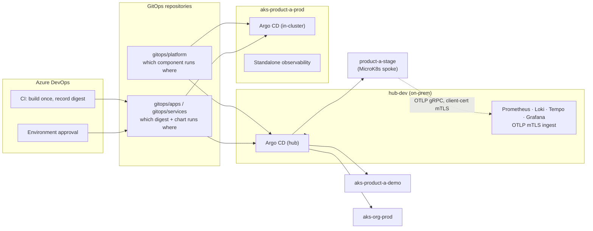
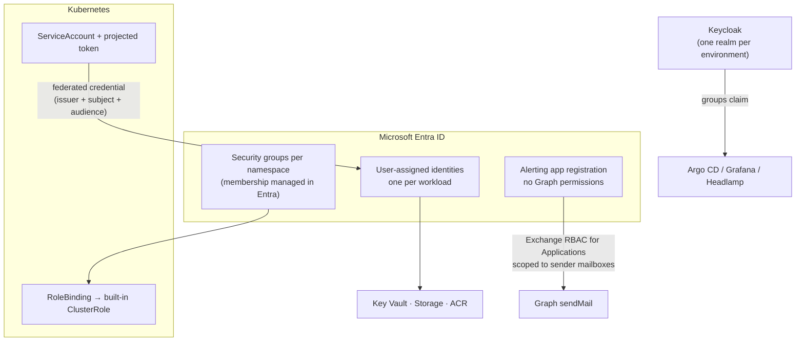
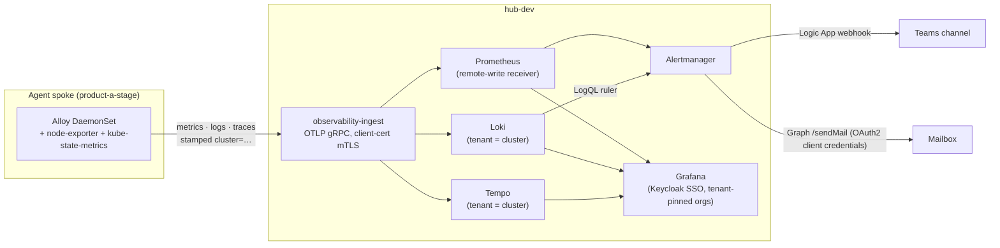
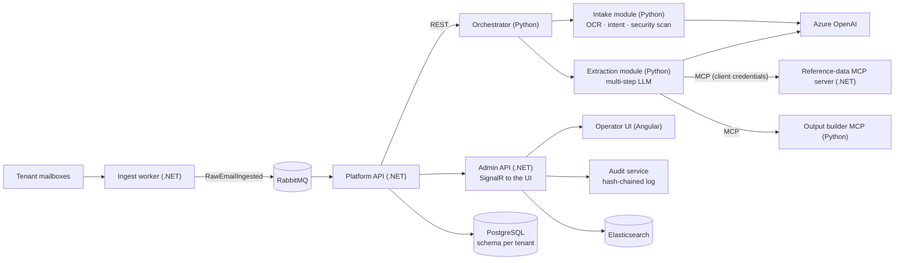

# Architecture

This is the platform as it ran: two products and a set of internal company services, on six Kubernetes clusters. The clusters are on-premises MicroK8s and Azure Kubernetes Service, and every one is driven by GitOps. All names are neutral placeholders. The shape, the numbers of moving parts and the trade-offs are real.

## Fleet

| Cluster | Kind | Role | Argo CD | Observability |
|---|---|---|---|---|
| `hub-dev` | On-prem MicroK8s, single node | **Hub.** Argo CD for every non-production cluster, central observability, company `dev` environment | Hub instance (`argocd-hub`) | Central: Prometheus, Loki, Tempo, Grafana, Alertmanager, OTLP mTLS ingest gateway |
| `product-a-stage` | On-prem MicroK8s | Product A stage | Managed by the hub | **Agent spoke**: Alloy ships metrics, logs and traces to the hub over one OTLP mTLS connection |
| `aks-product-a-demo` | AKS | Product A demo (customer-facing demos) | Managed by the hub | Standalone stack, alerts to its own channel |
| `aks-org-prod` | AKS, single node, office hours only | Company production (`services` environment) | Managed by the hub | Standalone stack |
| `aks-product-a-prod` | AKS, four node pools | Product A production | **Island**: own in-cluster Argo CD, manages only itself | Standalone stack with notifications |

The non-production estate shares one hub. Product A production deliberately does not.

**Why prod is an island.** The hub runs on hardware on the office network. A production cluster whose reconciler lives on that hardware fails whenever that box fails, and it widens the hub's blast radius to production. The island's Argo CD is installed by OpenTofu, then adopts itself through GitOps. See [ADR-0002](decisions/0002-two-argo-topologies.md).

## Repositories

The showcase is organised in four areas. Each folder inside an area stands for one or more real repositories.

| Area | Folder | Real repositories | Owns |
|---|---|---|---|
| app | [app](../app) | service repositories | The application side of the contract: Dockerfiles, charts, pipelines, runtime config |
| platform | [platform/charts](../platform/charts) | product platform charts, company platform charts | Helm charts for every shared component, including the Keycloak server |
| | [platform/ci-templates](../platform/ci-templates) | shared pipeline templates, per-repo templates | Build once, record, promote, PR gates, versioning, ADO bootstrap scripts |
| infra | [infra](../infra) | product IaC, company IaC | Azure: AKS, networks, databases, vaults, registries, backup, identities, alerting credentials, Keycloak realms |
| gitops | [gitops/platform](../gitops/platform) | product platform GitOps, company platform GitOps | Which platform component runs on which cluster, with per-cluster values |
| | [gitops/apps](../gitops/apps) | product application GitOps | Which digest and chart version of each Product A service runs in stage, demo and prod |
| | [gitops/services](../gitops/services) | company services GitOps | The same for the internal company services (dev, services) |

## Platform layer

Platform components are deployed in sync waves. Lower waves are things the higher ones depend on.

| Wave | Components | Why at this wave |
|---|---|---|
| 0 | secrets-store-csi, the `retain` StorageClass | Volumes and secrets must mount before anything stateful starts |
| 1 | cert-manager, vpa | Certificates are referenced by the Gateway |
| 2 | traefik (Gateway API CRDs + safe-upgrades policy), oidc-issuer | Every route attaches to the Gateway |
| 3 | reloader, rbac, rabbitmq, elasticsearch, mongo, azurite | Data services and namespace access |
| 4 | keycloak | Needs the database and the broker |
| 5 | argocd (self-managed handoff), cluster-test, trivy | Argo adopts itself only after its dependencies exist |
| 6–7 | observability, observability-ingest, cluster-monitoring-agent, log rules, grafana-sso-gateway | ServiceMonitor CRDs exist only from here; dashboards and SSO last |

**Production floor** (enforced in the charts and checked in CI):
- Every Deployment carries pool placement: a `pool` label plus a matching taint toleration.
- Stateless components run 2 or more replicas, with hard hostname spread and a PDB.
- Requests and limits are set everywhere.
- Two priority tiers apply. Node agents run at `system-node-critical`, so they can preempt. Platform services run at `system-cluster-critical`, so they can reschedule elsewhere.
- Documented single-replica exceptions: RabbitMQ and Elasticsearch, which are not clustered. They have retained volumes instead.

## Identity

- **Humans on AKS** use Entra ID only; local accounts are disabled. Namespace access is a RoleBinding from an Entra group to a built-in `edit` or `view` role, rendered by the `rbac` chart. The chart refuses an empty or malformed group ID, because Kubernetes accepts any string as a group subject and the resulting binding silently grants nothing.
- **Humans on platform tools** sign in through Keycloak: Argo CD, Grafana, Headlamp. Groups are declared in OpenTofu; membership is managed by people in the Keycloak console.
- **Workloads** use one user-assigned identity per workload, federated to its ServiceAccount, with role assignments scoped to the exact vault, container or registry.
- **Hub access to Azure DevOps.** The on-prem hub publishes its API server's OIDC discovery document. Argo CD's repo-server then exchanges its ServiceAccount token for an Entra token and reads Azure DevOps git **without a personal access token**. See [ADR-0007](decisions/0007-pat-free-git-access.md).

## Observability

- **Log contract.** Every service logs one JSON object per line to stdout, with fixed field names: `level`, `logger`, `trace_id`, `span_id`, `correlation_id`, `http_method`, `http_path`, `http_status`, `duration_ms`, `exception_type`. Alloy promotes `level` to a label and the rest to structured metadata. CI checks that every field a log alert filters on is actually extracted.
- **Alerts are code, and code has tests.** Metric rules are tested with `promtool`, log rules are linted with `lokitool`, and dashboard thresholds are checked against the rule that fires on them.
- **Severity routing:**

  | Severity | Destination | Repeat |
  |---|---|---|
  | `critical` | Teams and mail | Every 4h |
  | `warning` | Mail | Default |
  | `notice` | A quiet daily mail digest | Daily |
  | `Watchdog` | Dropped | — |

- **Credentials are files.** Alertmanager reads its credentials from files mounted by the CSI driver from Key Vault, so rotation never needs a restart or a commit.

## Product A (AI logistics SaaS)

Product A reads booking requests from tenant mailboxes and turns them into structured bookings. An operator reviews each booking, and the result is delivered into the tenant's own transport-management system.

- **Stack:** .NET 10 services, Python FastAPI LLM modules, and an Angular operator UI.
- **Messaging:** MassTransit on RabbitMQ.
- **Data:** PostgreSQL with one schema per tenant, plus an audit database with a per-tenant SHA-256 hash chain.
- **Identity:** Keycloak, one realm per environment.
- **Platform contract:** see [app/product-a](../app/product-a).

Product B is a transport-management system built by the same team. Its AI agents are a workflow layer over a deterministic domain, and deleting the agents folder leaves a complete system. An architecture test suite enforces that. It is delivered push-based to a dev namespace while its GitOps repository does not yet exist.

## Company services

The company services are internal applications delivered through `gitops/services`. Each has an API and a SPA:

| Service | API | Frontend |
|---|---|---|
| HR | .NET API | Four Angular SPAs sharing one chart |
| Payments | API, invoicing, headless e-mail worker | Admin SPA |
| Access (permissions) | API | App |
| Localisation | API | App |
| Food ordering | NestJS API | React app |

They share one AKS production cluster and one hostname. Each service gets a path prefix, and SPAs bake that prefix into the build (`baseHref`). Product B solves the same problem at runtime instead, so one image serves any prefix.
