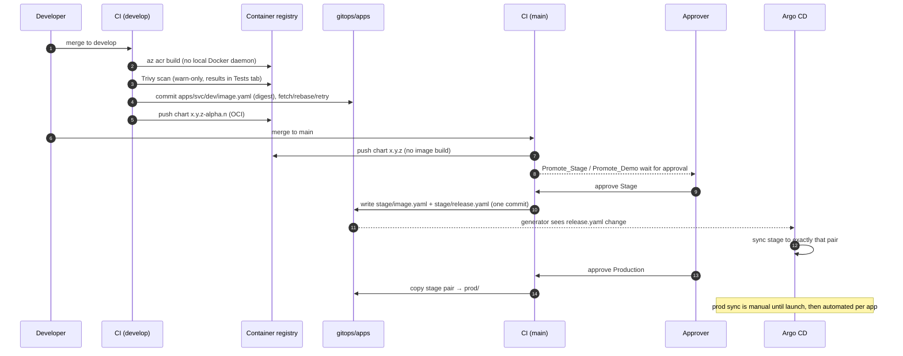
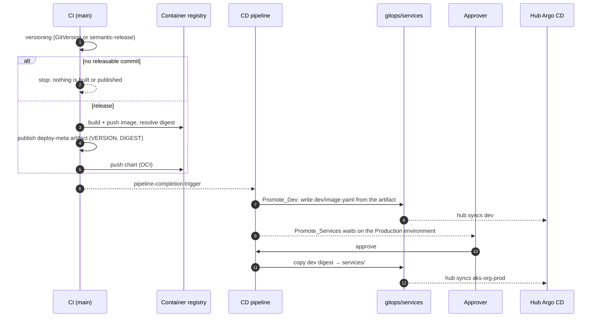

# Delivery flow

There are two variants of the same idea: **build an image once, identify it by its digest, and deploy by writing that digest into git behind an approval.** Argo CD only reconciles. It never decides what to deploy.

## The invariants

1. **One build per change.**
   - An image is built exactly once.
   - Every environment receives the byte-identical image, addressed by `sha256:` digest, never by tag. Tags are mutable; digests are content addresses.
2. **The approval is the deployment.**
   - Promotion is an Azure DevOps deployment job bound to an Environment with an approval check.
   - Approving it writes two plain-data files to the GitOps repository: `image.yaml` holds the digest, `release.yaml` holds the exact chart version.
   - Nobody edits an Argo CD manifest to deploy.
3. **Production equals stage.**
   - Production copies the exact image and chart pair that stage runs.
   - There is no path to production for anything that skipped stage.
4. **The file tree is the deployment model.**
   - A service runs in an environment if and only if `apps/<service>/<env>/release.yaml` exists.
   - An ApplicationSet with a git-files generator turns each file into an Application.
5. **Rollback is `git revert`** of the promotion commit.

## Variant A: product (develop builds, main promotes)

Templates: [build-or-promote-stage.yml](../platform/ci-templates/stages/build-or-promote-stage.yml), [gitops-record-steps.yml](../platform/ci-templates/steps/gitops-record-steps.yml), [gitops-promote-steps.yml](../platform/ci-templates/steps/gitops-promote-steps.yml).

## Variant B: company services (main builds, CD promotes)

Templates: [build-stage.yml](../platform/ci-templates/stages/build-stage.yml), [promote-stage.yml](../platform/ci-templates/stages/promote-stage.yml).

Variant B adds a release gate:
- **The gate.** semantic-release sets the next version only for a releasable commit (`feat:`, `fix:`, …). A `chore:` or `docs:` commit publishes nothing.
- **Why it matters.** Without the gate, a non-release would publish a real image and chart under a placeholder version. CD would then promote that placeholder into a production descriptor.

## Push-based dev (Product B, Product A dev)

Some environments are deployed by the pipeline with `helm upgrade` instead of GitOps:
- Product A dev is deployed this way because it lives on a developer cluster.
- Product B is deployed this way until its GitOps repository exists.

Order of operations:
1. **Refuse placeholders.** Any `<<NAME>>` left in a values file fails the run with file and line.
2. **Run the migration Job chart.** It deploys by digest only, with `--wait --wait-for-jobs`. Without `--wait-for-jobs`, Helm 4 reports success one second after creating a Job that fails nine seconds later.
3. **Deploy the application chart** by digest.

A separate *config-only* pipeline handles values-only changes. It reads the deployed chart version and image back from the Helm release, then upgrades only the values. It never rebuilds.

## Guards along the way

| Where | Guard | Failure it prevents |
|---|---|---|
| PR | Merge markers + pinned gitleaks scan (blocking) | A leaked credential reaching `main` |
| PR | `helm lint` + `helm template` with every env's values; no `{{ range }}` over config keys | A config key silently dropped or inverted at render time |
| PR | EF Core `has-pending-model-changes` | A model change shipped without its migration |
| PR (gitops/apps) | ConfigMap perturbation check | A key inherited from a chart default instead of stated in the environment |
| CI | Digest validated against `^sha256:[0-9a-f]{64}$` before anything is written | Recording a tag or an empty value as a deployable reference |
| CI | Chart rendered against the real GitOps values before it is pushed | A `ComparisonError` in Argo after the promotion has already happened |
| Promote | Refuse when `<env>/values.yaml` is missing | An Application that can never render while the environment keeps running the old image and the pipeline reports green |
| Promote | Refuse a chart pin older than the target's current one unless `allowDowngrade` | Approving a stale pending run silently rolling an environment back |
| Promote | `fetch` + `rebase` + retry on a non-fast-forward push | Two promotions racing and one approval being consumed with nothing written |
| Chart | Image helper fails without a digest | A mutable tag deployed |
| Chart | Required config keys fail the render when empty | An SPA starting with `localhost` placeholders that load fine and fail at runtime |
